# Instructivo para instalar R y RStudio en Windows

## ¿Qué son R y RStudio?

**R** es un lenguaje y un entorno de trabajo utilizado para realizar cálculos estadísticos, analizar datos y producir gráficos.

**RStudio** es un programa que facilita el uso de R mediante una interfaz más cómoda y organizada. Permite escribir código, ejecutar instrucciones, visualizar resultados, administrar archivos y crear gráficos.

Actualmente, RStudio es desarrollado por la empresa *Posit*, aunque el programa conserva el nombre RStudio.

> **Importante:** R y RStudio son dos programas diferentes. Primero se debe instalar **R** y, posteriormente, **RStudio**.

## Requisitos previos

Antes de comenzar, se recomienda verificar que:

- La computadora tenga Windows 10 o Windows 11.
- Se disponga de conexión a Internet.
- Se cuente con permiso para instalar programas.
- No haya otras instalaciones ejecutándose al mismo tiempo.

La versión actual de RStudio Desktop está diseñada para sistemas Windows de 64 bits y requiere que R se encuentre instalado previamente.

------------------------------------------------------------------------

# Parte I. Instalación de R

## Ingresar al sitio oficial de R

1.  Abrir un navegador de Internet, por ejemplo:

    - Google Chrome;
    - Microsoft Edge;
    - Mozilla Firefox.

2.  En la barra de direcciones escribir:

``` text
https://cran.r-project.org
```

3.  Presionar la tecla **Enter**.

Se abrirá la página principal de **CRAN**, el repositorio oficial desde el cual se distribuye R.

{width="500"}

------------------------------------------------------------------------

## Seleccionar la versión para Windows

En la página principal de CRAN:

1.  Buscar el apartado **Download and Install R**.
2.  Hacer clic en:

``` text
Download R for Windows
```

{width="500"}

------------------------------------------------------------------------

## Descargar el instalador

En la nueva página:

1.  Hacer clic en:

``` text
base
```

Esta opción permite descargar la versión básica y completa de R.

{width="500"}

2.  En la página siguiente, hacer clic en el enlace que comienza con:

``` text
Download R-
```

{width="500"}

El nombre exacto del archivo dependerá de la versión disponible. Por ejemplo:

``` text
Download R-4.x.x for Windows
```

3.  Esperar a que termine la descarga.

El archivo descargado tendrá extensión `.exe` y normalmente se guardará en la carpeta **Descargas**.

> Se recomienda descargar siempre la versión más reciente disponible en el sitio oficial.

------------------------------------------------------------------------

##Ejecutar el instalador de R

1.  Abrir la carpeta **Descargas**.
2.  Buscar el archivo descargado. Su nombre será similar a:

``` text
R-4.x.x-win.exe
```

3.  Hacer doble clic sobre el archivo.

Windows puede mostrar una ventana con la pregunta:

``` text
¿Quieres permitir que esta aplicación haga cambios en el dispositivo?
```

4.  Seleccionar **Sí**.

## Seleccionar el idioma

Al comenzar la instalación aparecerá una ventana para seleccionar el idioma.

1.  Elegir **Español**.
2.  Hacer clic en **Aceptar**.

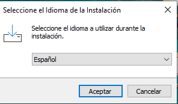{width="301"}

------------------------------------------------------------------------

## Aceptar la información de la licencia

Se mostrará información sobre la licencia de uso de R.

1.  Leer la información.
2.  Hacer clic en **Siguiente**.

R es software libre y puede utilizarse gratuitamente.

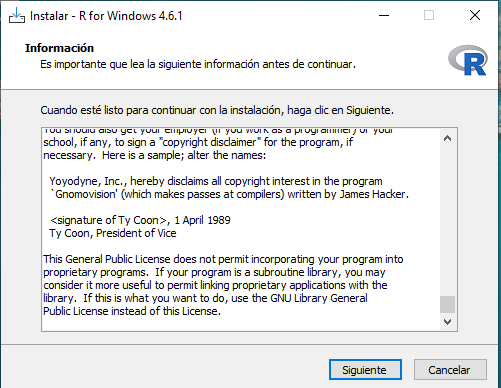{width="317"}

## 9. Elegir la carpeta de instalación

El instalador propondrá una ubicación similar a:

``` text
C:\Program Files\R\R-4.x.x
```

Se recomienda mantener esta ubicación.

1.  No modificar la carpeta propuesta.
2.  Hacer clic en **Siguiente**.

------------------------------------------------------------------------

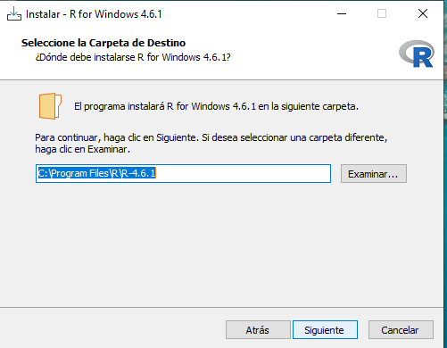{width="317"}

## Seleccionar los componentes

El instalador mostrará los componentes que se instalarán.

1.  Mantener seleccionadas las opciones predeterminadas.
2.  Hacer clic en **Siguiente**.

En las computadoras actuales se instalará la versión de R para sistemas de 64 bits.

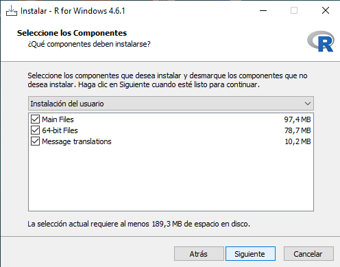{width="333"}

------------------------------------------------------------------------

## Configurar las opciones de inicio

Cuando el instalador pregunte si se desean personalizar las opciones de inicio:

1.  Seleccionar:

``` text
No
```

2.  Hacer clic en **Siguiente**.

Esta opción mantiene la configuración recomendada para usuarios principiantes.

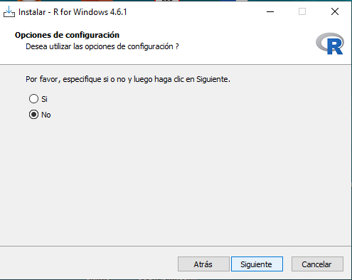{width="339"}

## Crear accesos directos

El instalador permitirá seleccionar algunas tareas adicionales.

Se recomienda mantener seleccionadas las siguientes opciones:

- Crear un acceso directo en el escritorio.
- Crear un acceso directo en el menú Inicio.
- Registrar el número de versión.
- Asociar los archivos `.RData` con R.

Luego, hacer clic en **Siguiente**.

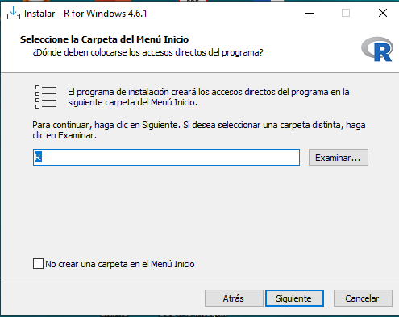{width="295"}

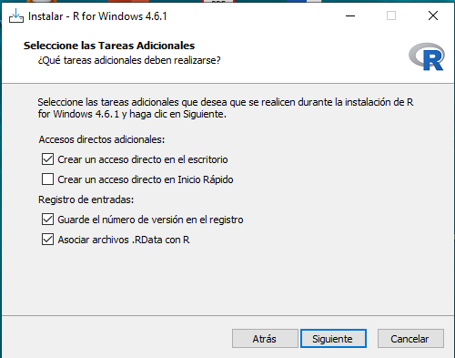{width="298"}


## Finalizar la instalación de R

El programa comenzará a copiar los archivos necesarios.

1.  Esperar a que finalice el proceso.
2.  Hacer clic en **Finalizar**.

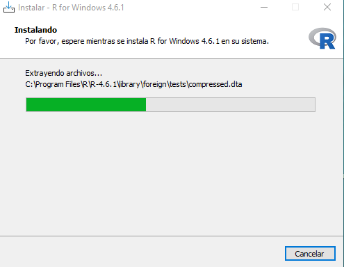{width="292"}

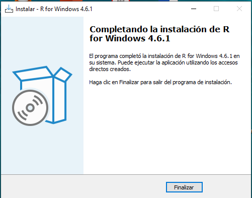{width="289"}

------------------------------------------------------------------------

## Comprobar que R funciona correctamente

1.  Abrir el menú **Inicio** de Windows.
2.  Buscar la aplicación **R**.
3.  Hacer clic para abrirla.

Se mostrará una ventana denominada **R Console**.

En la consola, junto al símbolo `>`, escribir:

``` r
2 + 2
```

Presionar **Enter**.

El resultado esperado es:

``` text
[1] 4
```

Si aparece este resultado, R se instaló correctamente.

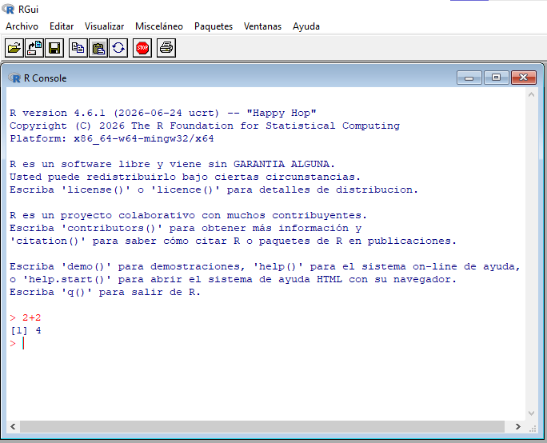{width="300"}


Después de comprobar la instalación, se puede cerrar la ventana de R.

# Parte II. Instalación de RStudio Desktop

RStudio es desarrollado por la empresa **Posit**. La edición de código abierto de RStudio Desktop puede descargarse gratuitamente para Windows.

## Ingresar al sitio oficial para descargar RStudio

1.  Abrir nuevamente el navegador.
2.  Ingresar a:

``` text
https://posit.co/download/rstudio-desktop/
```

3.  Hacer clic en el botón de descarga para Windows.

El sitio normalmente detectará automáticamente el sistema operativo y ofrecerá un archivo con un nombre similar a:

``` text
RStudio-2026.xx.x-xxx.exe
```

El número puede variar según la versión disponible.

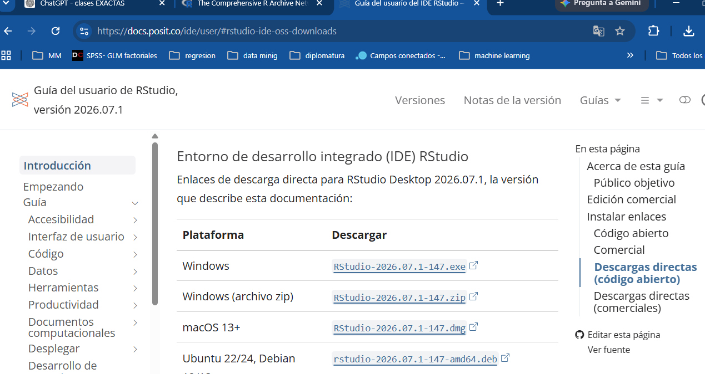{width="401"}

La descarga oficial para Windows se distribuye mediante un archivo ejecutable `.exe`.

------------------------------------------------------------------------

##  Ejecutar el instalador de RStudio

1.  Abrir la carpeta **Descargas**.
2.  Buscar el archivo de instalación de RStudio.

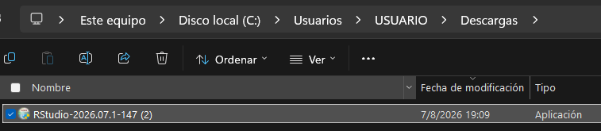

3.  Hacer doble clic sobre el archivo.

Si Windows pregunta si se permite que la aplicación realice cambios:

4.  Seleccionar **Sí**.
5.  Se abrira el instalador de RStudio

## Iniciar el asistente de instalación

Aparecerá la ventana del asistente de instalación de RStudio.

1.  Hacer clic en **Siguiente**.

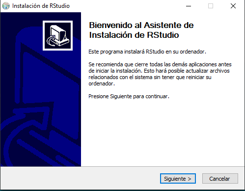{width="347"}

------------------------------------------------------------------------

## Seleccionar la carpeta de instalación

El instalador propondrá una carpeta similar a:

``` text
C:\Program Files\RStudio
```

1.  Mantener la ubicación sugerida.
2.  Hacer clic en **Siguiente**.

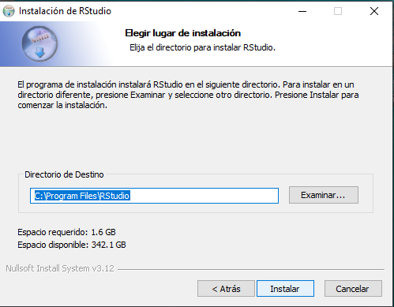{width="388"}

## Seleccionar la carpeta del menú Inicio

El programa propondrá crear un acceso dentro del menú Inicio.

1.  Mantener el nombre **RStudio**.

2.  Hacer clic en **Instalar**.

## Finalizar la instalación de RStudio

Esperar mientras se copian los archivos.

Cuando aparezca el mensaje indicando que la instalación se completó:

1.  Hacer clic en **Terminar**.

El instalador crea un acceso a RStudio y registra el programa entre las aplicaciones instaladas en Windows.

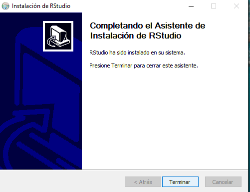{width="389"}

------------------------------------------------------------------------

# Parte III. Primera ejecución de RStudio

##Abrir RStudio

Para iniciar el programa:

1.  Abrir el menú **Inicio**.
2.  Escribir:

``` text
RStudio
```

3.  Hacer clic sobre la aplicación.

También puede aparecer un acceso directo en el escritorio.

------------------------------------------------------------------------

# Lista de comprobación final

Antes de comenzar las actividades, verificar que se hayan completado los siguientes pasos:

- [ ] R fue descargado desde CRAN.

- [ ] R fue instalado correctamente.

- [ ] RStudio Desktop fue descargado desde Posit.

- [ ] RStudio fue instalado correctamente.

- [ ] RStudio abre sin mostrar errores.

- [ ] La operación `2 + 2` devuelve `[1] 4`.

------------------------------------------------------------------------

# Sitios oficiales

## Descarga de R

``` text
https://cran.r-project.org
```

## Descarga de RStudio Desktop

``` text
https://posit.co/download/rstudio-desktop/
```

> Para evitar problemas de seguridad o versiones modificadas, se recomienda descargar ambos programas únicamente desde sus páginas oficiales.
